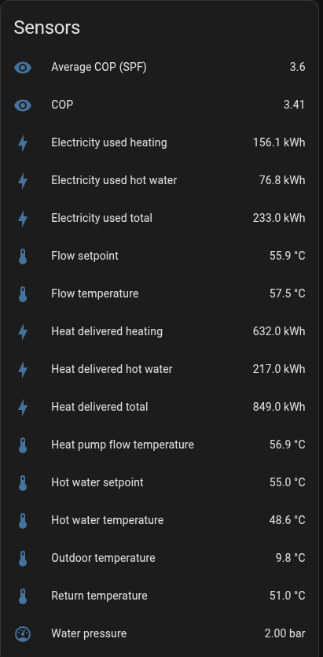

# Remeha Bluetooth (unofficial)

> Community project. Not made, endorsed or supported by Remeha / BDR Thermea.
> "Remeha" is used only to say which heat pumps this works with.

[](https://my.home-assistant.io/redirect/hacs_repository/?owner=martijnvwezel&repository=remeha-bluetooth-ha&category=integration)

Read your Remeha heat pump (Confida, Elga Ace, Eria, R290 ...) in Home Assistant
through the Bluetooth module (EHC-16) that is already in the heat pump.
No cloud, no account, no extra hardware. You only need the **6-digit PIN** on the
sticker of the Bluetooth module.

You get: **what it is doing right now** (heating, hot water, standby, defrost ...), **COP** (now and average since installation), outdoor / flow / return / hot water temperatures, water pressure,
and **electricity used** + **heat delivered** (kWh, works in the Energy dashboard).



## Install (5 minutes)

1. Home Assistant must be **close to the heat pump** and have Bluetooth
   (built-in Bluetooth or a USB Bluetooth stick on the Home Assistant machine).
2. Install [HACS](https://hacs.xyz) if you don't have it.
3. Click the **Open in HACS** button above (or HACS → ⋮ → *Custom repositories* →
   `https://github.com/martijnvwezel/remeha-bluetooth-ha`, type *Integration*),
   then *Download*.
4. Restart Home Assistant.
5. Settings → Devices & services. Your heat pump shows up under **Discovered**
   (named `EHC-16_...`). Click **Add**.
6. Type the PIN from the sticker → **Submit**. Wait up to a minute. Done:
   a device **Heat pump** with sensors like `sensor.heat_pump_cop`.

No HACS? Copy the folder `custom_components/remeha_bluetooth` into
`/config/custom_components/` and restart.

## Track the heat pump in the Energy dashboard

See exactly how much electricity the heat pump uses, next to your other devices:

1. Settings → Dashboards → **Energy** (or open the Energy dashboard → ⋮ → *Energy settings*).
2. Under **Individual devices** click **Add device**.
3. Pick **Heat pump Electricity used total** → *Save*.

Bars appear from the next full hour. Want the split between heating and hot water?
Also add **Electricity used heating** and **Electricity used hot water**, and set
*Upstream device* of both to **Electricity used total**, so nothing is counted twice.

The heat delivered sensors show how much heat you got for that electricity:
heat delivered ÷ electricity used = your average COP (also shown as *Average COP (SPF)*).

## Nederlands, kort

Zet Home Assistant (met Bluetooth) in de buurt van de warmtepomp, installeer deze
integratie via HACS, herstart, en klik bij *Instellingen → Apparaten & diensten*
op **Toevoegen** bij `EHC-16_...`. Vul de 6-cijferige pincode van de sticker in. Klaar.

Stroomverbruik volgen: *Energie-instellingen → Individuele apparaten → Apparaat toevoegen*
→ kies **Heat pump Electricity used total**.

## Problems

| Message | What to do |
|---|---|
| *No module found* | Home Assistant is too far away, or Bluetooth is off. |
| *Module refused this PIN* | Check the sticker; wait 1 minute (module locks after a wrong PIN). |
| *Could not connect* | Close the Remeha app on phones nearby (only one connection at a time). |

Only one device can be connected to the module at a time: while Home Assistant is
connected, the Remeha app can't connect.

## Status

**Status** shows what the heat pump is doing (the AM012 code from the Remeha app):
*Heating*, *Hot water*, *Heat demand*, *Standby*, *Pump post-run*, *Frost protection* ...
**Sub status** (diagnostic) gives the detail, e.g. *Normal internal setpoint* or *Defrost with HP*.
Handy for automations, like "notify when it starts making hot water".

## How it works

See [`spec_folder/SPEC.md`](spec_folder/SPEC.md). In short: BLE bonding with the PIN,
two fixed challenge/response handshakes, then reading the monitoring block every 30 s.

Values beyond the first few temperatures are verified on a Confida; other models may
put some values at other positions. Please open an issue with a screenshot of the
Remeha app if a value looks wrong.

## Development

```
pip install pytest-homeassistant-custom-component
pytest                        # flow + sensor + protocol tests with a fake gateway
python3 tools/try_client.py   # talk to a real module from a Linux laptop
```

## Support

[](https://www.buymeacoffee.com/muino)

MIT licensed. Not affiliated with Remeha / BDR Thermea.
